<div align="center">

# ShadeNet Downloader

**A fast, tidy download manager for Windows.** Many connections per file, pause and resume that survives a crash,
videos from YouTube and hundreds of other sites, live-stream recording, and a browser extension that takes downloads over
with your sign-in. Everything is in the box: no .NET, no extra tools to install.

[](https://github.com/shade-sdev/ShadeNetDownloader/releases/latest)
&nbsp;
**[⬇ Download the installer](https://github.com/shade-sdev/ShadeNetDownloader/releases/latest)**

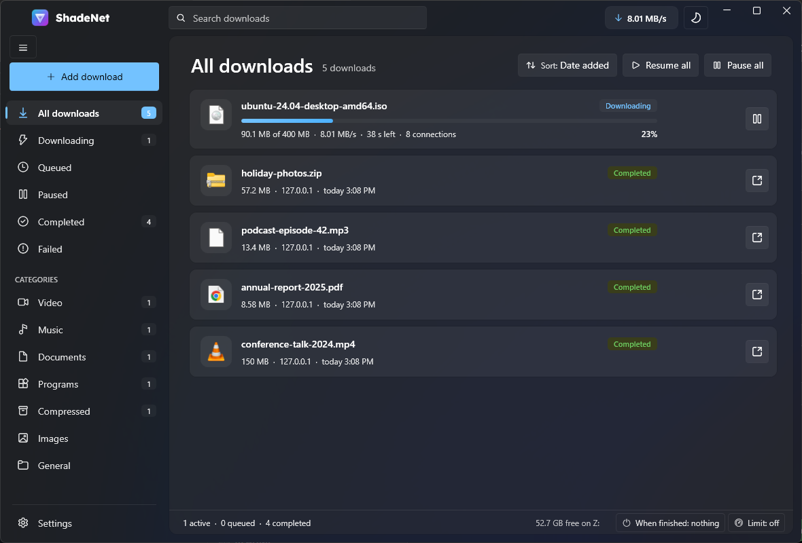

</div>

---

## Contents

1. [What it does](#what-it-does)
2. [Install](#install)
3. [A first look](#a-first-look)
4. [Downloading files](#downloading-files)
5. [Videos, streams and live recordings](#videos-streams-and-live-recordings)
6. [Torrents](#torrents)
7. [The browser extension](#the-browser-extension)
8. [Queue, schedule and "when finished"](#queue-schedule-and-when-finished)
9. [Settings, page by page](#settings-page-by-page)
10. [Keyboard shortcuts](#keyboard-shortcuts)
11. [Updates](#updates)
12. [Troubleshooting](#troubleshooting)
13. [Privacy and limits](#privacy-and-limits)
14. [Building from source](#building-from-source)
15. [Credits](#credits)

---

## What it does

| | |
|---|---|
| **Fast** | A file is fetched over several connections at once, all opened right away (fewer for a small file). A connection that is cut off asks again at once, one that turns out far slower than the others is replaced, and free connections take over the work of slow ones. A site that allows only a few connections is noticed and remembered, so the next download from it starts within its limit. Up to 32 connections per file. |
| **Safe to interrupt** | Pause, resume, close the program: unfinished downloads continue where they stopped. After a crash or a power cut they continue from the last saved point, a few seconds back. Every download is kept in a small local database. |
| **Videos** | Paste the address of a YouTube (or Facebook, Instagram, X, TikTok, Vimeo, Reddit …) video page, choose a quality, and ShadeNet downloads it. HLS and DASH streams are fetched in parallel and joined without re-encoding. Subtitles can be saved or put inside the file. |
| **Live recordings** | A live stream is recorded until you press **Stop and save** (or until a length limit you set). |
| **Torrents** | Magnet links and `.torrent` files (from the Add dialog, the browser, or Windows): pick the files and their priority, download in order to watch while it arrives, see the peers, files and trackers, pause and resume across restarts, and share back what you downloaded until a limit you set. |
| **Browser extension** | For Chrome, Edge, Brave, other Chromium browsers and Firefox. It hands your downloads to ShadeNet **with the cookies and headers the site needs**, puts a **Download video** button on videos, named after the video, and sends a page's links to the link grabber. |
| **Link grabber** | The files a page links to (or the links you selected), listed to pick from: narrow them by kind or words, put them in one folder, download them with the page's sign-in. |
| **Archives** | Finished zip, 7z, rar, tar and gz archives, also in several parts, can be unpacked automatically or with a right-click; a password is asked for, and every file is checked against the archive's checksums. |
| **One network adapter** | Bind everything (downloads, videos, recordings, torrents) to your VPN's adapter: while it is down nothing goes out, and downloads wait for it instead of failing. |
| **Tidy** | Downloads are sorted into category folders (Video, Music, Documents, Programs …). A queue with a schedule, a speed limit, search, sorting, and a details view with a live speed graph and a map of the file. |
| **Yours to style** | Light, dark or Windows' own; ready-made themes, gradient themes, and a choice of app icons. |
| **Self-updating** | It looks for a newer version about once a day and **asks** before installing it. |

---

## Install

1. Open the **[latest release](https://github.com/shade-sdev/ShadeNetDownloader/releases/latest)** and download
   `ShadeNetDownloader-Setup-<version>.exe` (about 300 MB: the whole program, yt-dlp, ffmpeg and 7-Zip are inside).
2. Run it. **No administrator rights are needed**; ShadeNet installs for your user only.

<div align="center">
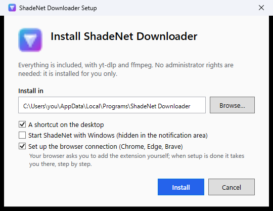
</div>

3. Choose the options, press **Install**:
   * *A shortcut on the desktop* (a Start menu entry is always made);
   * *Start ShadeNet with Windows* (it starts hidden in the notification area);
   * *Set up the browser connection* (Chrome, Edge, Brave); see [The browser extension](#the-browser-extension).

> **Windows SmartScreen** may say the app is from an unknown publisher: the installer is not code-signed yet. Choose
> **More info → Run anyway**. The release page lists SHA-256 checksums (`SHA256SUMS.txt`) if you want to verify the download.

**Where things are.** The program is installed in `%LOCALAPPDATA%\Programs\ShadeNet Downloader`; your settings and the list of
downloads are in `%LOCALAPPDATA%\ShadeNet` (Settings → About → *Data folder → Open*). Your downloaded files go to your
`Downloads` folder by default.

**Install from a script** (for IT or your own setup):

```text
ShadeNetDownloader-Setup-<version>.exe /S /D="C:\Tools\ShadeNet"
```

Add `--no-desktop-shortcut`, `--no-start-menu-shortcut`, `--no-browser-integration`, `--startup` (start with Windows) or
`--launch` as needed.

**Uninstall** from *Settings → Apps → Installed apps*. Your downloads and settings stay (so a reinstall finds them); the
uninstaller asks whether to delete them as well. Silent: `Uninstall.exe --uninstall --silent` (add `--remove-data` to also
delete the data folder).

**Upgrading** by running a newer setup over an installed ShadeNet works too (it asks a running ShadeNet to quit first), but
normally the program updates itself: see [Updates](#updates).

---

## A first look

* **Left:** *Add download*, the lists (*All downloads, Downloading, Queued, Paused, Completed, Failed*) with live counts, and your
  **categories**. *Settings* is at the bottom. The menu button at the top folds the bar to icons.
* **Centre:** the downloads. Each card shows the name, a progress bar, size, speed, time left and the number of connections.
  Buttons on a card: pause/resume, details, open the folder, remove. **Right-click** a card for everything else.
* **Top:** search (type to filter the list), the current total speed, and a theme toggle.
* **Bottom bar:** how many are active/queued/completed, free disk space, **When finished** (what to do when everything is done),
  and the **speed limit**.

Closing the window **keeps ShadeNet running in the notification area** (so downloads and the browser connection carry on).
Use **Exit** in the tray menu to quit for real. Both behaviours can be changed in Settings → General.

<div align="center">
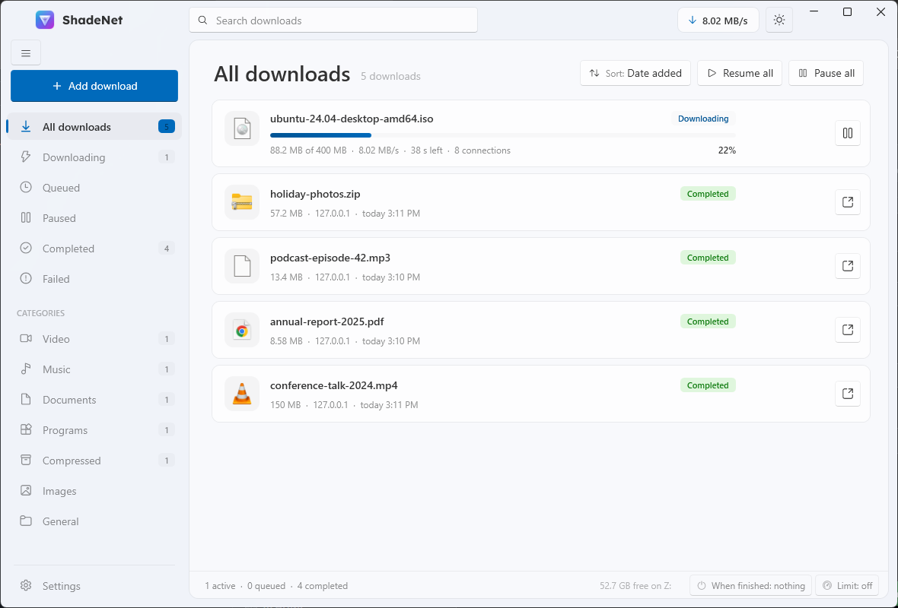
</div>

---

## Downloading files

### Add a download

Press **Add download** (or **Ctrl+N**), or just press **Ctrl+V** anywhere in the window with a link on the clipboard.

<div align="center">
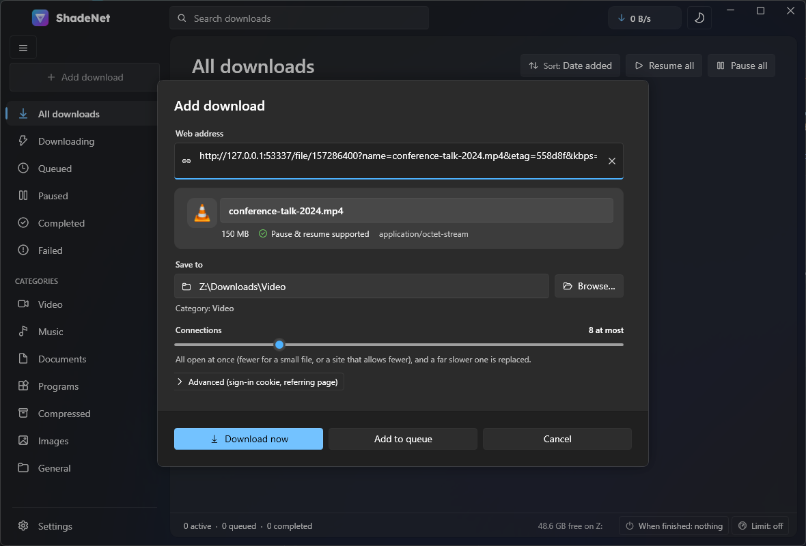
</div>

1. **Paste the address.** ShadeNet looks at it at once: the file name, the size, whether the server supports pause and resume.
   You can **paste several links** (one per line) to add them as a batch.
2. **Name and folder.** The name can be changed; *Save to* follows the file's category (here *Video*), or choose another folder with
   **Browse…**.
3. **Connections.** The slider sets the most connections ShadeNet may use for this file (default 8). They all open at once (fewer for
   a small file, or for a site that allows fewer), and one that turns out far slower than the others is replaced.
4. **Advanced** holds a sign-in cookie and a referring page, for links that only answer a signed-in browser. (The
   [browser extension](#the-browser-extension) fills these in for you.)
5. Choose **Download now** to start, or **Add to queue** to let it wait its turn.

### The link grabber

Paste the address of a **web page** instead of a file: the Add dialog says it is a page and offers **Grab the links on it…**. (In the
browser, right-click a page, or a selection on it, and choose **Download links with ShadeNet…**.) The grabber lists the files the
page links to, with the words the page showed for them:

* **Files only** hides links to other pages; the kinds above the list (*Compressed (12)*, *Video (3)* …) show or hide each kind, and the
  box narrows the list by name or address.
* Tick the files you want (**Choose all shown** ticks the visible ones), and optionally **put them in one folder** named after the page.
* **Download N files** starts them, **Add to queue** queues them. The page is sent as their referring page; links the browser sent go with
  your sign-in on each site.

### Archives

Turn on **Extract archives when they finish** (Settings → Downloads → *Archives*), or right-click a finished archive and choose
**Extract**. ShadeNet unpacks zip, 7z, rar, tar (and .tar.gz/.bz2/.xz) and gz files, also archives in several parts (`name.part1.rar`,
`name.rar` + `.r00`, `name.7z.001` …): it waits until the last part has arrived. The files go to a new folder next to the archive
(named after it, or the archive's own folder when everything in it is in one); nothing is overwritten. An archive locked with a
password asks for it (also a RAR in several parts). Every file is checked against the archive's own checksum, so a damaged archive is
reported, not unpacked wrong. Optionally the archive then goes to the Recycle Bin. The unpacking is done by
[7-Zip](https://www.7-zip.org), which comes with ShadeNet (see [The helper programs](#the-helper-programs)).

### Managing downloads

* **Pause / resume** with the button on the card, **Space**, or a double-click. **Pause all / Resume all** are at the top of the list.
* **Select several** cards (Ctrl/Shift-click, or *Select all*) and act on them together.
* **Right-click** a card: Open, Open with…, Details, Pause/Resume, Add to queue, Move to top/up/down/bottom, Refresh address,
  Open the page it came from, Show in folder, Copy link, **Remove from list**, **Remove and delete file**.
* **Remove** (the **Delete** key) takes a download off the list and keeps the file; an **Undo** appears for a few seconds.
* **Refresh address** gets a new link for a download whose link expired (it asks the page the download came from).
* **Sort** by name, type, size or date, ascending or descending; **filter** with the lists and categories on the left, or search.

### Details, connections and speed

Open a card's **Details** (the *i* button, **Alt+Enter**, or right-click → Details) to see what the engine is doing.

<div align="center">
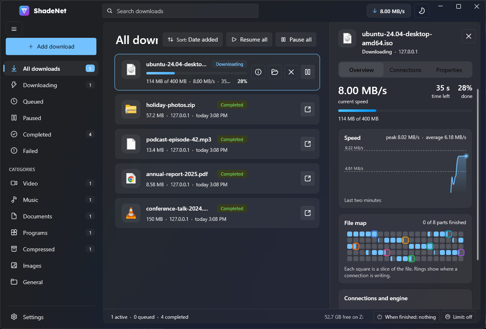
</div>

* **Overview:** current speed, time left, a graph of the last two minutes, and the **file map**: every square is a slice of the file,
  and a coloured ring shows where a connection is writing right now.
* **Connections:** one row per connection with its own speed and the range of the file it is fetching.
* **Properties:** the file's details, plus a **speed limit for this download only** and its own number of connections.

<div align="center">
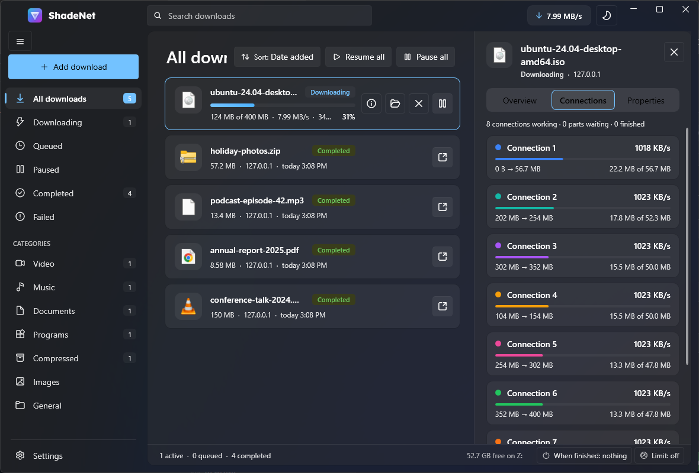
</div>

**Speed limit for everything:** the *Limit* button in the bottom bar. Choose a preset or type a speed; a download can also have
its own limit in its details.

<div align="center">
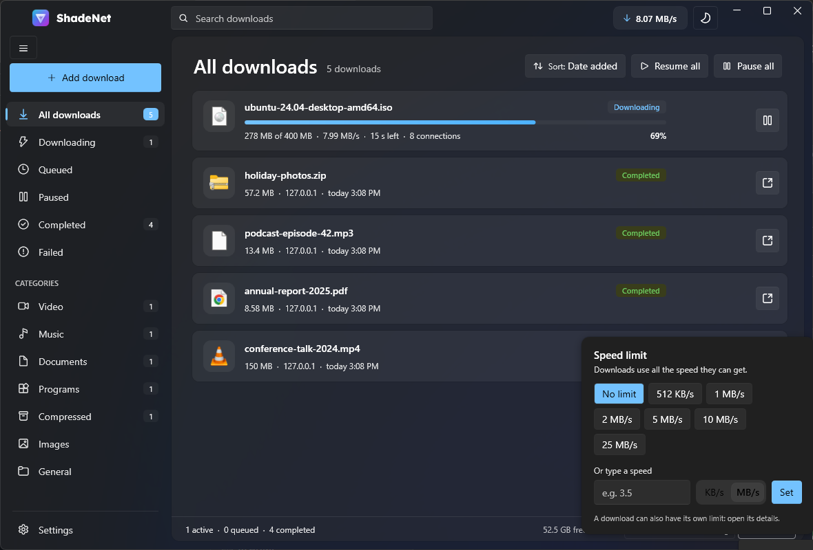
</div>

### Categories

A finished download is sorted by its file type into **Video, Music, Documents, Programs, Compressed, Images** or **General**,
each with its own folder under your download folder. The file types and folders are yours to edit, and you can add categories
(Settings → Categories). Turn the sorting off in Settings → Downloads to keep everything in one folder.

---

## Videos, streams and live recordings

You don't need to do anything special: **paste the address of the video's page** (or use the
[extension's button](#the-browser-extension)) and the Add dialog asks yt-dlp what is there.

<div align="center">
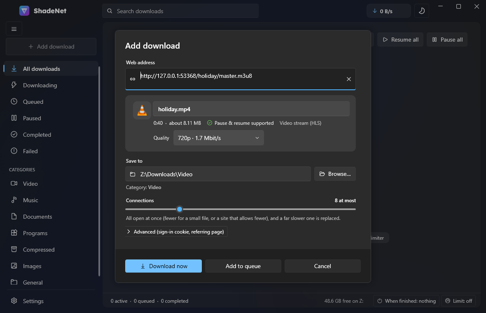
</div>

* **Quality:** pick one from the list. Pictures and sound that are kept apart are downloaded in parallel and **joined without
  re-encoding** (so no quality is lost).
* **Where it works:** YouTube and the many sites yt-dlp reads (Facebook, Instagram, X, TikTok, Vimeo, Reddit …), plain **HLS**
  (`.m3u8`) and **DASH** (`.mpd`) streams, and ordinary video files. ShadeNet does the downloading itself (many connections,
  pause and resume); yt-dlp only works out where the video is.
* **Subtitles** are offered when the video has them: as separate files or inside the MP4/MKV.
* **Protected (DRM) videos are refused**, with the reason. ShadeNet does not circumvent copy protection.

### Recording a live stream

When the address is a live stream the dialog says so: *"Recording starts now and goes on until the broadcast ends or you press
Stop and save on its card."*

<div align="center">
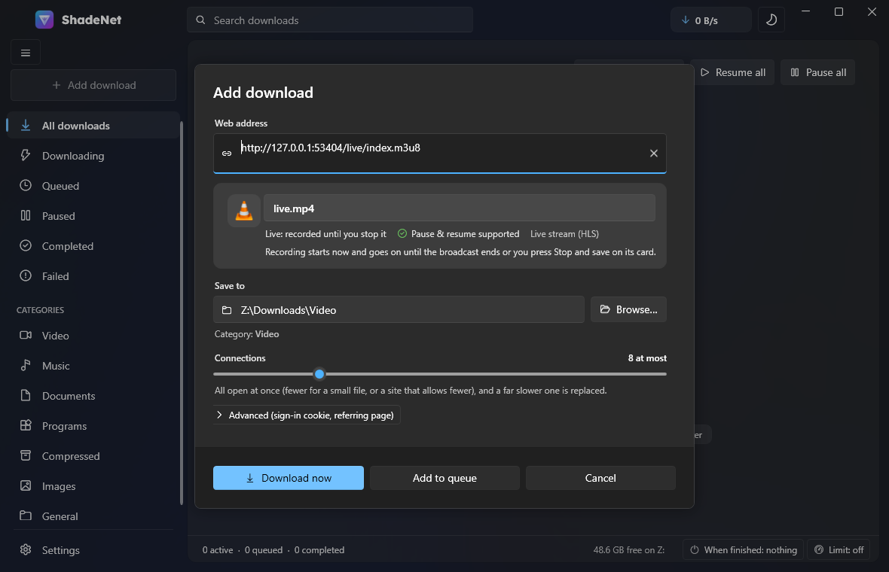
</div>

The card shows **Recording**, how long has been recorded and the size. The square **stop button** on the card (or right-click →
**Stop and save**) ends the recording and saves what was recorded as a normal video file. A recording starts a couple of minutes
behind the live edge, and stopping is quick even for streams with hours of history.

<div align="center">
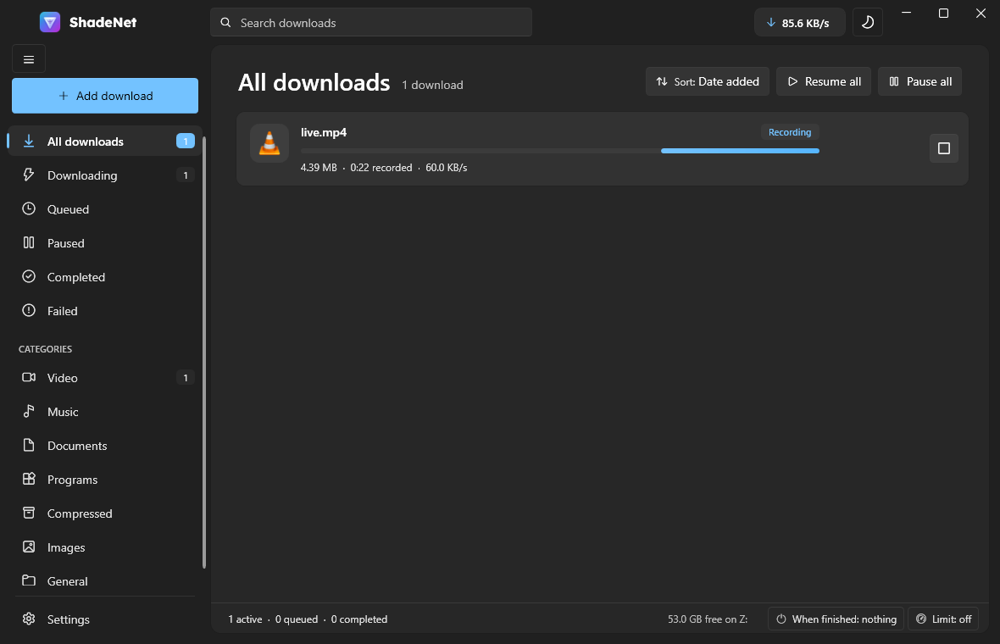
</div>

To limit a recording automatically, set **Stop live recordings after (minutes)** in Settings → Downloads (0 = no limit).
*Stop and save* finishes a recording and keeps the file. (*Pause* is different: on a recording made from a stream's pieces it keeps the
recording open so it can be continued later; a recording made by ffmpeg is saved when paused.)

### The helper programs

**yt-dlp**, **ffmpeg** and **7-Zip** (which unpacks finished archives) come with ShadeNet (in `tools\` next to the program) and are
used automatically; a 7-Zip installed on the computer is used when the bundled one is missing. Settings → Downloads →
*Helper programs* shows which copy is used and its version, lets you point to your own copy, and has a **Check** button. About
once a day ShadeNet also looks for newer versions and **asks** before installing any.

---

## Torrents

**Paste a magnet link**, press **Open .torrent file…** in the Add dialog, or drop a `.torrent` file on the window. A link to a
`.torrent` file on the web works too. With the browser extension, a **magnet link you click** on a page opens in ShadeNet, and a
`.torrent` file the browser downloads becomes a torrent (fetched with your sign-in on that site). And Windows can open magnet links
and `.torrent` files with ShadeNet (see below).

<div align="center">
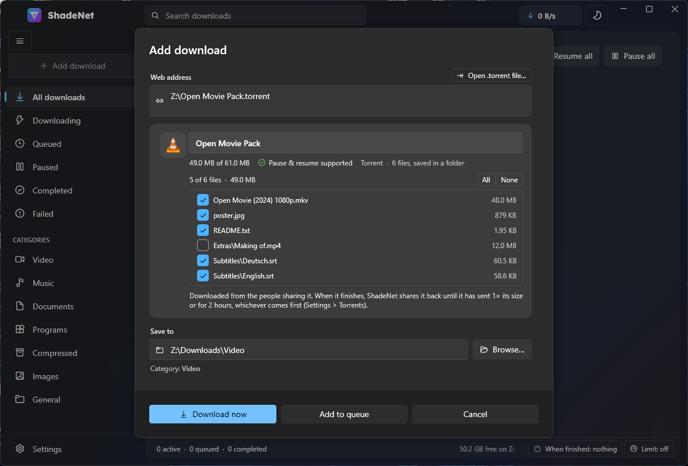
</div>

* **Pick the files.** The dialog lists what the torrent holds; untick what you don't want. A torrent of several files is saved
  as a folder named after it, one of a single file as that file. The category follows the largest file (a film's folder goes to
  Video).
* **Magnet links** carry no file list: it comes from the people sharing the torrent, which can take a moment. You can press
  **Download now** before it arrives; every file is then downloaded.
* **Download in order** (in the Add dialog, or in the drawer's *Files* tab) fetches the pieces from the start of the files, so a
  film can be watched while the rest arrives. The usual way (rarest pieces first) is faster for everyone, so it is off by default.
* **Pause and resume** work as for any download, also across restarts: what is on the disk is kept and checked, not fetched again.
  The speed limits (one download's, and the total in the bottom bar) hold torrents back too.
* **Sharing back.** Torrents work because people share what they downloaded. When a torrent finishes, its card says **Sharing**
  and ShadeNet sends pieces to others until it has sent as much as the torrent's size, or for 2 hours, whichever comes first.
  Sharing doesn't take a place in the queue, and it carries on after ShadeNet restarts until a limit is reached. Change the limits
  (or turn sharing off) in Settings → Downloads → *Torrents*; right-click a finished torrent for **Stop sharing** or **Share again**.
* **Safety.** A torrent that names a file outside its own folder is refused. The same torrent can't be added twice.

<div align="center">
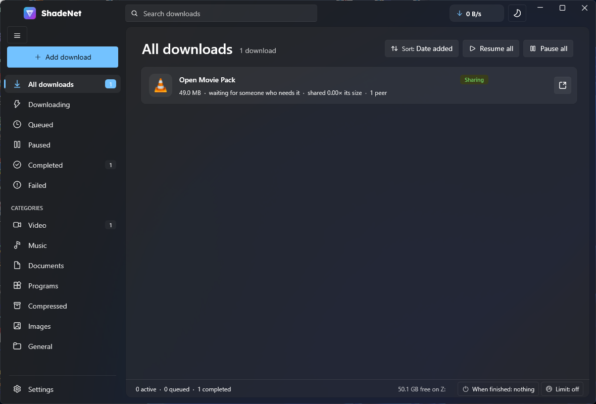
</div>

### A torrent's details

Open a torrent's details (the **ⓘ** button on its card, or **Alt+Enter**). Next to *Overview* and *Properties* it has three tabs of
its own:

* **Peers:** everyone the torrent is connected to: their address and program, how much of the torrent they have, and the speed in
  each direction. The **⊘** button on a peer **bans** its address: it is disconnected from every torrent and never connected to
  again (Settings → Downloads → *Torrents* lists the banned addresses and unbans them). **Add a peer** connects to someone you
  know shares the torrent (`203.0.113.7:51413`, or `[2001:db8::7]:51413` for IPv6).
* **Files:** every file with its progress and a priority: **High** (fetched first), **Normal** or **Skip** (not downloaded).
  Change them while it runs. Asking for a file of a finished torrent downloads it (what is there stays). The *Download in order*
  switch is here too.
* **Trackers:** each tracker, whether it answers and how many it says share the torrent, and the DHT. **Add trackers** (one
  address per line) and **✕** take trackers on and off; the changes stay when the torrent starts again. A private torrent takes no
  other tracker.

The *Overview* shows the torrent's pieces as a map (every piece of the whole torrent, the skipped files too), the peers, how much
it has shared, and the **whole swarm as the trackers count it** (the card shows it too). Two buttons: **Ask for peers now** asks
every tracker, the DHT and the local network at once rather than at their next turn, and **Check the files again** checks every
piece on the disk against the torrent and downloads whatever is missing or damaged (also on the card's right-click menu; a paused
torrent is checked when it next starts). The Add dialog already says how many share a torrent before you add it.

<div align="center">
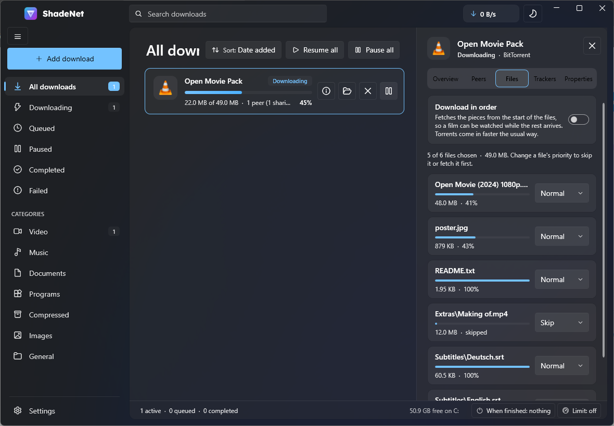
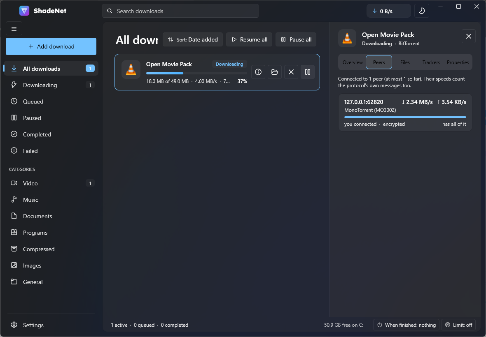
</div>

### Opening magnet links and .torrent files from Windows

Turn on **Open magnet links and .torrent files with ShadeNet** in Settings → Downloads → *Torrents*. ShadeNet is then offered for
them by Windows ("Open with", Default apps). It becomes the program that opens them only if no other program does yet. If one does
(another torrent program), it stays in charge until you choose ShadeNet in Windows' **Default apps**: the setting shows a button
that opens that page. A magnet link opened while ShadeNet runs goes to its Add dialog. Turning the setting off, or uninstalling
ShadeNet, removes everything it registered.

---

## The browser extension

The extension lets ShadeNet take over your browser's downloads and add a **Download video** button to videos. It works in
**Chrome, Edge, Brave** and other Chromium-based browsers, and in **Firefox** (see below).

### Set it up (once)

If you left *Set up the browser connection* ticked in the installer, its last page walks you through this. Otherwise:

1. In ShadeNet open **Settings → Browser** and press **Set up** (this registers ShadeNet with your browsers; no administrator
   rights needed).
2. In your browser open `chrome://extensions` (or `edge://extensions`) and turn on **Developer mode**.
3. Press **Load unpacked** and choose the folder
   `%LOCALAPPDATA%\Programs\ShadeNet Downloader\browser\chromium` (Settings → Browser shows the exact path and has buttons that open
   the page and the folder).

<div align="center">
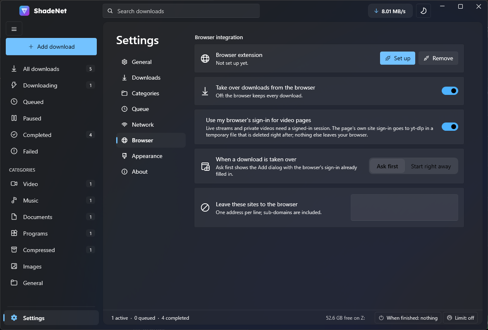
</div>

Browsers don't let a program add an extension for you, so that last click is yours. The extension can talk only to ShadeNet (its
ID is fixed and ShadeNet accepts nothing else), and it **updates with the program**: after an update it reloads itself.

**Firefox:** press **Set up** as above (it registers ShadeNet with Firefox too), then **Add to Firefox** in Settings → Browser. Firefox
keeps only add-ons signed by Mozilla: a release that carries the signed add-on installs it with one click. Without it, Firefox runs the
add-on until it closes (Settings → Browser shows the steps: *Load Temporary Add-on…* on Firefox's `about:debugging` page).
Maintainers sign it with `pwsh tools/build-firefox-addon.ps1 -Sign` (an addons.mozilla.org API key is needed; see the script).

### What you get

* **Downloads are taken over.** When the browser starts a download, the extension pauses it, asks ShadeNet, and if ShadeNet takes
  it, the browser's own copy is cancelled. If ShadeNet can't be reached the browser's download just continues: **a failure never
  loses a download.** Sign-in cookies, the referring page and the browser's identity travel with it, so links that only answer a
  signed-in browser work.
* **Right-click → Download with ShadeNet** on a link, video or audio (a magnet link too).
* **Right-click → Download links with ShadeNet…** on a page (or on text you selected) sends its links to the
  [link grabber](#the-link-grabber), with your sign-in on each site they point to.
* **Magnet links you click** open in ShadeNet's Add dialog, with the torrent's files (*Open magnet links I click with ShadeNet*
  in Settings → Browser; off, the browser handles them as before). A **`.torrent` file** the browser downloads becomes a torrent
  in ShadeNet, fetched with your sign-in on that site (in the Add dialog you can keep just the `.torrent` file instead).
* **A Download video button on videos.** When a page plays something ShadeNet can download, a small button appears on the video
  with its **name, length and quality**. One click sends it; the file is saved under the video's name. It also works for videos
  inside embedded players and for sites that hide the video's address.

<div align="center">
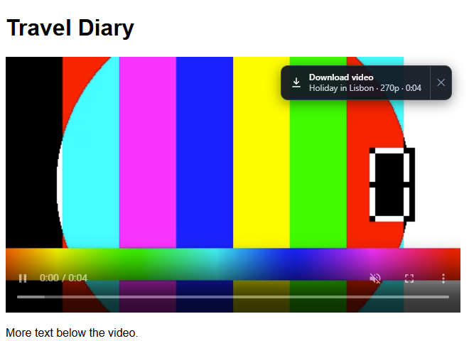
</div>

* **Several videos on one page** are listed by name in a menu on the button, and the toolbar badge counts them.

<div align="center">
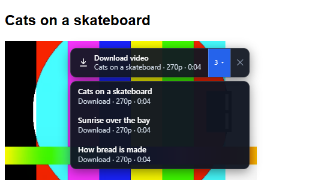
</div>

* **The toolbar popup** says whether ShadeNet is running (it looks **without starting it**) and has two switches: *Send downloads
  to ShadeNet* and *Show a Download button on videos*. Nothing to click to connect: it finds the app by itself.

<div align="center">
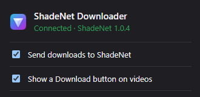
</div>

* If ShadeNet isn't running when a download starts, the extension starts it (minimised).

### Choose how it behaves

In **Settings → Browser** you can switch the takeover off, choose **Ask first** (the Add dialog opens with the sign-in already
filled in) or **Start right away**, list **sites to leave to the browser**, and decide whether your browser's sign-in may be used
for video pages that need it (live streams and private videos). Changes reach the extension immediately.

---

## Queue, schedule and "when finished"

* **Queued** is the list of downloads waiting their turn. ShadeNet runs **3 downloads at the same time** by default (Settings →
  Queue); the rest wait and start as others finish. Reorder them with right-click → *Move to top / up / down / bottom*, and start
  or stop the whole queue.
* **Schedule:** *Run the queue on a schedule* limits the queue to a time window on chosen days, for example at night when
  bandwidth is free.
* **When finished** (bottom bar, or Settings → Queue): *Do nothing, Close ShadeNet, Sleep, Hibernate* or *Shut down the computer*
  when every download is done. It applies to this session only and is never saved; a 60-second countdown with a **Cancel** button
  comes first.

<div align="center">
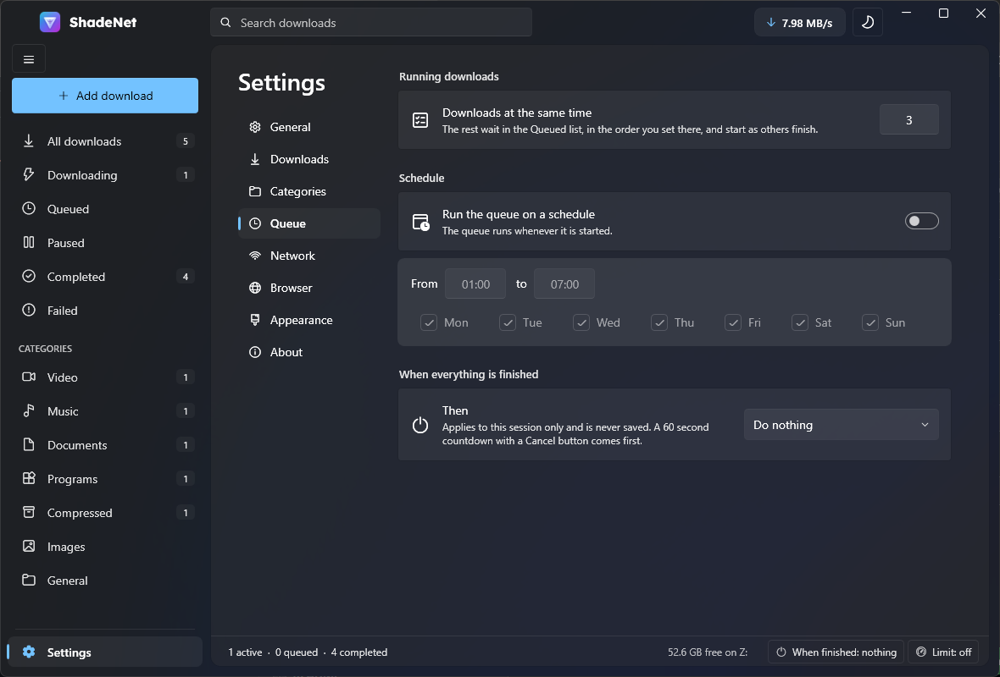
</div>

---

## Settings, page by page

Open **Settings** (bottom left, or **Ctrl+,**).

<details>
<summary><b>General</b>: tray icon, closing behaviour, start with Windows, notifications</summary>

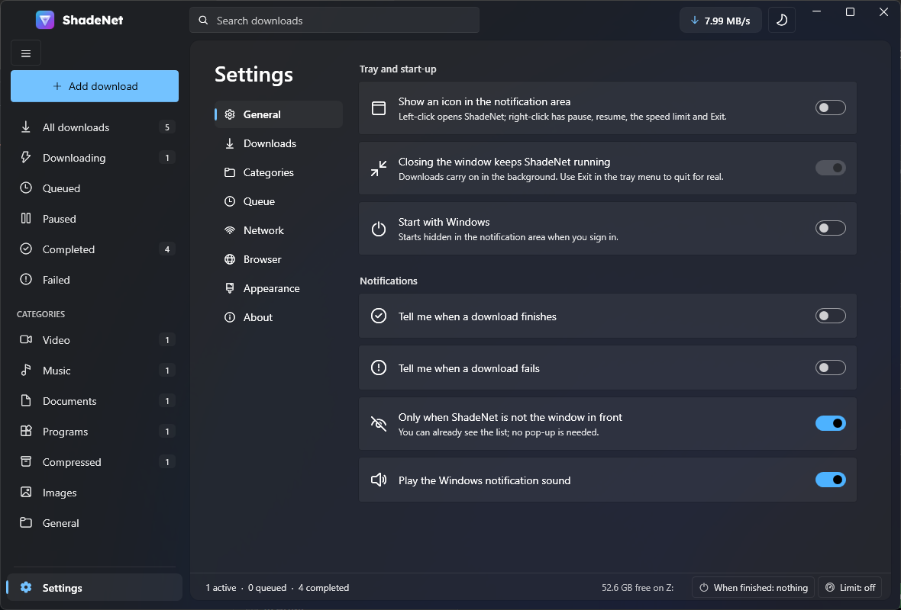

* **Show an icon in the notification area:** left-click opens ShadeNet; right-click has pause, resume, the speed limit and Exit.
* **Closing the window keeps ShadeNet running** (downloads carry on in the background).
* **Start with Windows:** starts hidden in the notification area when you sign in.
* **Notifications** when a download finishes or fails, optionally only when ShadeNet isn't the window in front, with or without
  the Windows notification sound. Clicking a notification shows the file in its folder (ShadeNet never runs a file for you).
</details>

<details>
<summary><b>Downloads</b>: folder, connections, resume on start, recording limit, torrents, helper programs</summary>

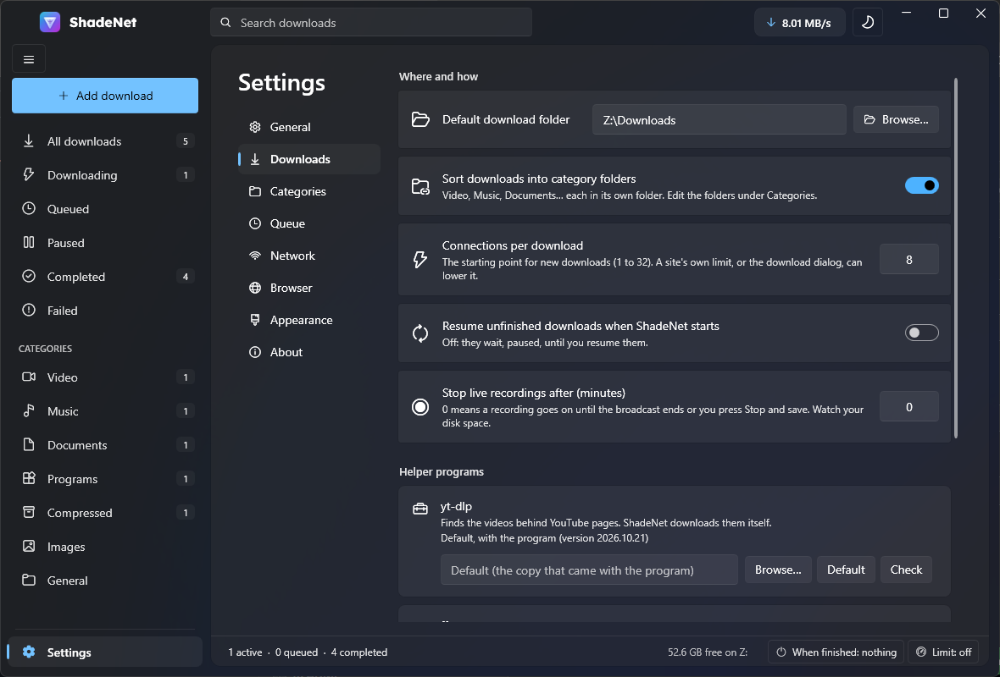

* **Default download folder** and **Sort downloads into category folders**.
* **Connections per download:** the starting point for new downloads (1 to 32). A site's own limit, or the Add dialog, can lower it.
* **Resume unfinished downloads when ShadeNet starts:** off means they wait, paused, until you resume them.
* **Stop live recordings after (minutes).**
* **Archives:** *Extract archives when they finish*, and *…then put the archive in the Recycle Bin* (see [Archives](#archives)).
* **Torrents:** *Open magnet links and .torrent files with ShadeNet* (see [above](#opening-magnet-links-and-torrent-files-from-windows)),
  how long a finished torrent is shared (until it has sent *N* × its size, or for so many minutes; 0 turns
  sharing off), an upload speed limit for all torrents, the port other peers connect to (0 = a free one each start, over IPv4
  and IPv6), and three switches: finding peers without a tracker (DHT, which most magnet links need), asking the router to forward
  the port (UPnP), and finding peers on the local network. Then:
  * **Encrypt connections to peers:** *Prefer encrypted* (the most peers), *Encrypted only* (some networks slow down torrent
    traffic they can recognise) or *Off*.
  * **Send torrents through the proxy:** with a proxy set in Settings → Network (an HTTP proxy, or `socks5://host:port`, with
    `user:password@` if it needs a sign-in), trackers and peers are reached only through it. What a proxy cannot carry (UDP
    trackers, the DHT, local peers, port forwarding) is then not used. A line under these settings says how torrents reach the
    network right now.
  * **Banned peers**, with **Unban all**.
* **Helper programs:** yt-dlp, ffmpeg and 7-Zip (see above).
</details>

<details>
<summary><b>Categories</b>: which file types go where</summary>

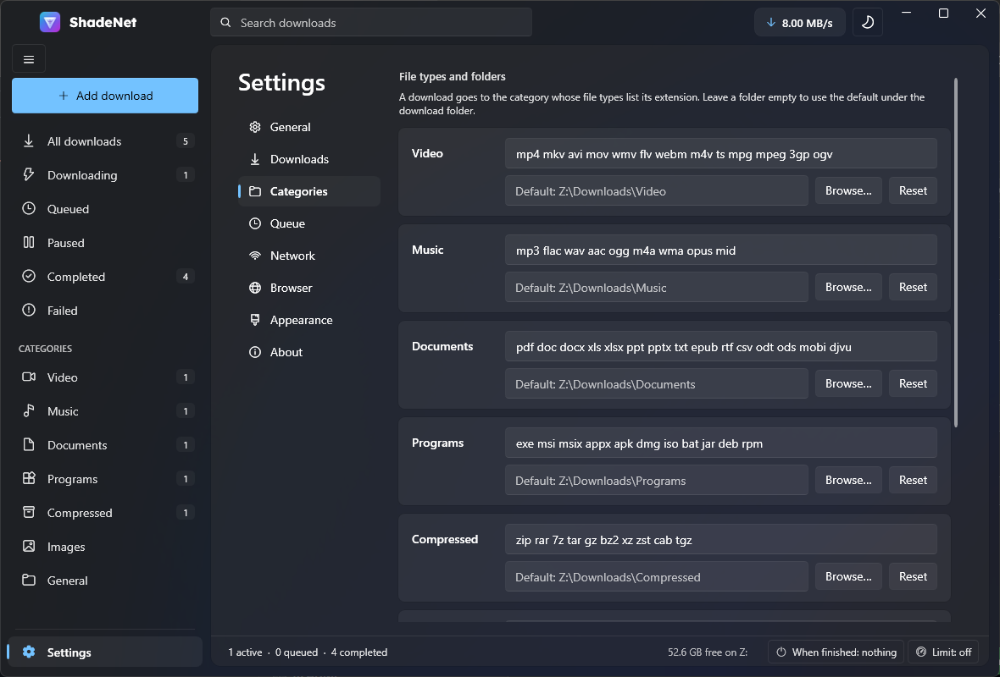

A download goes to the category whose list of file types names its extension. Leave a folder empty to use the default under the
download folder; **Browse…** picks another; **Reset** goes back. You can add your own categories.
</details>

<details>
<summary><b>Queue</b>: how many at once, schedule, when everything is finished</summary>

See [Queue, schedule and "when finished"](#queue-schedule-and-when-finished).
</details>

<details>
<summary><b>Network</b>: proxy, time-outs, retries, browser identity, connections per site</summary>

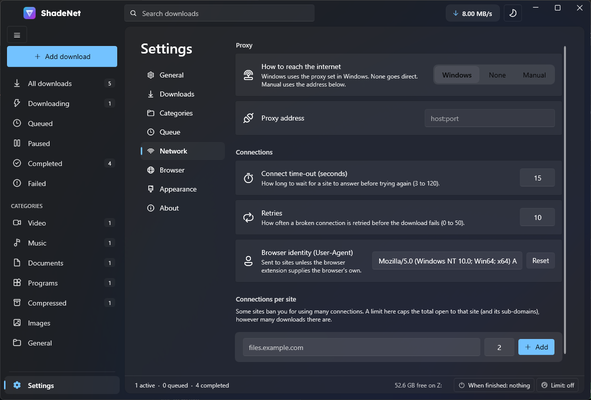

* **Use only this network adapter:** e.g. your VPN's. Downloads, videos, recordings and torrents then use only its addresses: while
  it is not connected, nothing goes out and downloads say *Waiting for … to connect* instead of failing (a kill switch); they carry on
  once it is back. Name lookups still use Windows' own DNS.
* **How to reach the internet:** *Windows* (the proxy set in Windows), *None* (direct) or *Manual* (`host:port` for an HTTP proxy,
  or `socks5://host:port`; `user:password@` before the host for a sign-in). yt-dlp and torrents use it too.
* **Connect time-out** (3 to 120 s) and **Retries** (0 to 50) before a broken download fails. The first retry of a connection
  is immediate; after that ShadeNet waits a little longer each time, and always as long as a busy server asks (`Retry-After`).
* **Browser identity (User-Agent)** sent to sites unless the extension supplies the browser's own.
* **Connections per site:** some sites ban you for opening many connections; a limit here caps the total open to that site (and
  its sub-domains), however many downloads are running there. You rarely need it: when a site turns extra connections away
  (429 or 503), ShadeNet keeps to the number it serves, and the next downloads from that site (for an hour, while ShadeNet runs)
  start with no more.
</details>

<details>
<summary><b>Browser</b>: the extension and how it takes over downloads</summary>

See [The browser extension](#the-browser-extension).
</details>

<details>
<summary><b>Appearance</b>: themes, gradient themes, app icons, your own look</summary>

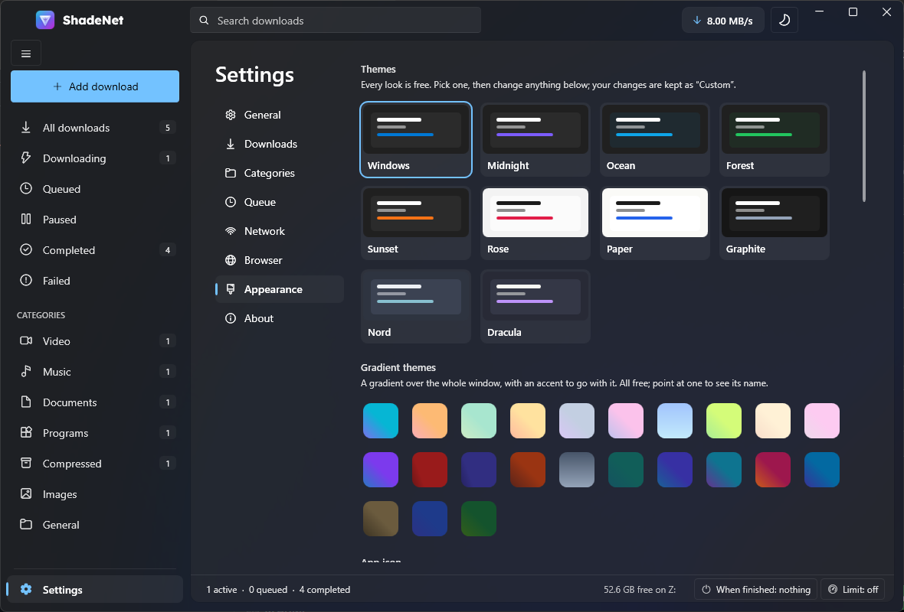

* **Themes:** Windows, Midnight, Ocean, Forest, Sunset, Rose, Paper, Graphite, Nord, Dracula. Pick one, then change anything below;
  your changes are kept as *Custom*.
* **Gradient themes:** a gradient over the whole window with an accent to go with it.
* **App theme:** *System* follows Windows and changes with it live; or *Light* / *Dark*. The sun/moon button at the top of the
  window cycles through them.
* **Accent colour, layout** and more below.
* **Import a theme…** and **Share this look…** let you exchange themes as files.

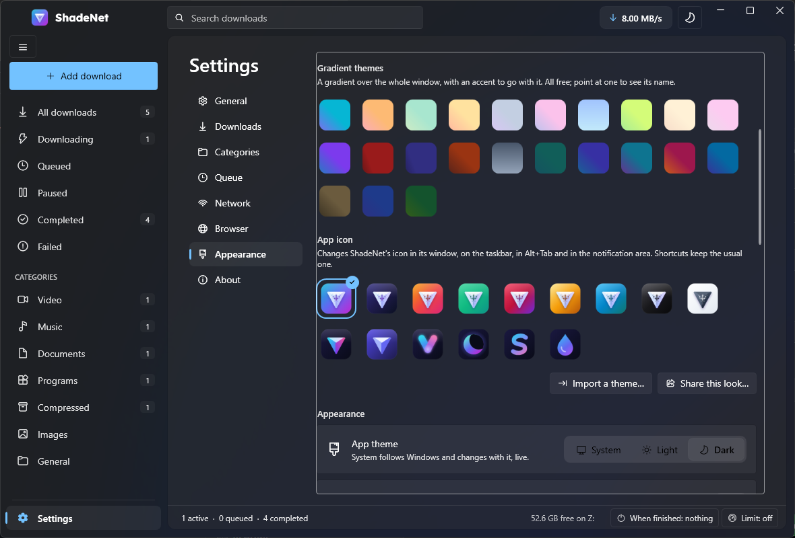

**App icon:** choose the icon ShadeNet shows in its window, on the taskbar, in Alt+Tab and in the notification area. Shortcuts
keep the usual icon.
</details>

<details>
<summary><b>About</b>: version, updates, data folder</summary>

* The installed **version**, a **Check for updates** button, and the switch *Look for a newer ShadeNet automatically* (about once a
  day; it always asks before installing).
* The **data folder**, with a button that opens it.
</details>

---

## Keyboard shortcuts

| Keys | What it does |
|---|---|
| **Ctrl+N** | Add download |
| **Ctrl+V** | With a link on the clipboard (and not typing in a text box): open the Add dialog with it |
| **Ctrl+F** | Search the list |
| **Ctrl+,** | Open Settings |
| **Space** | Pause / resume the selected downloads |
| **Enter** | Open the selected finished download (**Alt+Enter** opens its details) |
| **Delete** | Remove the selected downloads from the list (file kept; Undo is offered) |
| **Esc** | Close the details drawer; with it closed, clear the selection |
| **Double-click** a card | Open it when finished, otherwise pause / resume |

---

## Updates

* **ShadeNet itself:** about once a day it looks at this repository's latest release. When there is a newer version it tells you
  (a notification with an **Update** button, and *Settings → About*). Nothing is installed without your OK. The update is a
  small package that is **verified (size and SHA-256)** before use; ShadeNet then closes, replaces its own files, and starts again.
  Your downloads, settings, shortcuts and helper programs are untouched, and a failed update puts the old version back.
  Running downloads are paused and saved, and continue afterwards.
* **yt-dlp, ffmpeg and 7-Zip:** checked about once a day too, with the same "ask first" rule. A new 7-Zip comes from its author's
  own releases (github.com/ip7z/7zip) and is checked against GitHub's SHA-256 before it is used.
* A copy of ShadeNet that was not installed with the setup program (for example one you built yourself) says that a new version
  exists but cannot update itself; it links to the release page instead.

Turn the automatic look off in *Settings → About*; **Check for updates** still works whenever you press it.

---

## Troubleshooting

| Problem | What to try |
|---|---|
| **A video page says "nothing downloadable"** | The site may need you to be signed in: in the browser, sign in, then use the extension's button (with *Use my browser's sign-in for video pages* on). Protected (DRM) videos can't be downloaded. |
| **A download fails with a web page instead of the file** | The link needs your browser's session or has expired. Use the extension, or **Advanced** in the Add dialog, or right-click → **Refresh address**. Some sites allow each link only once. |
| **The extension says *ShadeNet is not running*** | That's not a fault: start ShadeNet (or press **Start ShadeNet** in the popup). |
| **The extension says *Not connected*** | Its second line gives the reason. Open *Settings → Browser* and press **Set up** again, which rewrites the registration. |
| **"Specified native messaging host not found"** | Press **Set up** in *Settings → Browser*, then restart the browser. |
| **Downloads are slow** | Check the speed limit in the bottom bar, the *Connections per site* list in Settings → Network, and your proxy setting. |
| **A magnet link stays at *Getting the file list from peers…*** | Nobody sharing it was found yet. Leave it: it starts as soon as a peer answers. Check that *Find peers without a tracker (DHT)* is on in Settings → Downloads; an old or rare torrent may have nobody left. |
| **A torrent downloads slowly or says *Looking for peers…*** | Few people share it (the swarm count on its card tells). Turning on *Ask the router to forward the port* helps others connect to you; allow ShadeNet if Windows asks about the firewall. Through a proxy, only HTTP trackers can be asked: add some in Details → Trackers. |
| **A download says *Waiting for … to connect*** | ShadeNet is bound to that network adapter (Settings → Network) and it is not connected: connect your VPN, or choose *Any network*. |
| **An archive was not extracted** | Right-click it → **Extract** says why: a part still missing, a password, a damaged archive, or 7-Zip missing (Settings → Downloads → *Helper programs*). |
| **I can't find the window** | ShadeNet is probably in the notification area (closing the window keeps it running): click its icon. |
| **The taskbar or desktop icon looks old after an update** | Windows keeps the picture of an icon it has seen. From version 1.0.5 an update refreshes the shortcuts' pictures, and from 1.0.6 the taskbar button follows the icon you choose in Settings → Appearance. On older versions, update ShadeNet first. |

Log files: the browser connection writes `%LOCALAPPDATA%\ShadeNet\host.log`; a crash writes `crash.log` in the data folder.

---

## Privacy and limits

* ShadeNet runs entirely on your computer. It has **no account and no telemetry**. The only things it contacts are the sites you
  download from, GitHub (the daily look for updates), and the publishers of yt-dlp, ffmpeg and 7-Zip (their own daily look).
* **Torrents are shared in public.** While a torrent downloads or is shared, everyone in its swarm (and its trackers) can see your
  IP address, and your internet provider can see that you use BitTorrent. ShadeNet opens no port for torrents until you add one.
  A proxy or a VPN adapter (Settings → Downloads → *Torrents*) hides your address from them; encryption only hides what you share
  from your provider, not that you use BitTorrent.
* The extension sends a download's sign-in cookies, referring page and browser identity **to ShadeNet on your computer**, only for
  that download. Your browser sign-in for a video page goes to yt-dlp in a temporary file that is deleted right after.
* **DRM-protected video is not supported** and never will be.
* Please download only what you have the right to.
* The installer and program are **not code-signed** yet (SmartScreen will warn).
* Browser extension: Chromium browsers only; it is loaded unpacked (Chrome shows a *developer mode extensions* notice at start-up).
* Windows only (64-bit). It is built and tested on Windows 11.

---

## Building from source

You need the **.NET 10 SDK** (pinned in `global.json`) and Windows. Node.js 22 is only needed for the extension's tests.

```powershell
git clone https://github.com/shade-sdev/ShadeNetDownloader.git
cd ShadeNetDownloader
dotnet build                                   # the whole solution
dotnet run --project src/ShadeNetDownloader    # start the app
pwsh tools/ci/test.ps1                         # every test suite, as the release pipeline runs them
pwsh tools/get-tools.ps1 -Tool all             # fetch yt-dlp, ffmpeg and 7-Zip (verified) into tools/
pwsh tools/build-release.ps1                   # the installer and the update package in dist/
```

Set `SHADENET_DATA_DIR` to run against a throw-away data folder.

| Folder | What is in it |
|---|---|
| `src/ShadeNet.Core` | The download engine: probing, segmenting, resume, speed limiter, HLS/DASH, recording, torrents, updates |
| `src/ShadeNetDownloader` | The WPF app ([WPF-UI](https://github.com/lepoco/wpfui), .NET 10) |
| `src/ShadeNet.Bridge`, `src/ShadeNet.NativeHost` | The pipe and native-messaging host between the browser and the app |
| `src/ShadeNet.Setup` | The installer, the uninstaller and the updater (one project) |
| `extension/chromium` | The Manifest V3 browser extension |
| `tests/` | Engine, program, bridge, installer and extension tests |
| `tools/` | Build, release and end-to-end scripts, the command-line test tool |

**Releases.** Every merge to `master` is a release: the workflow in `.github/workflows/release.yml` picks the next version
(`v<MAJOR.MINOR>.N`), runs all tests, builds the installer and the update package, checks them, and publishes them with
`update.json` and checksums. Add `[skip ci]` to a commit message to skip a release (for a documentation-only change, say).
Installed programs read `releases/latest/download/update.json` to learn about the newest version.

---

## Credits

* [yt-dlp](https://github.com/yt-dlp/yt-dlp) (Unlicense) finds the videos behind web pages.
* [ffmpeg](https://ffmpeg.org/) (LGPL build) joins pictures, sound and subtitles.
* [WPF-UI](https://github.com/lepoco/wpfui) for the Windows 11 look.
* [MonoTorrent](https://github.com/alanmcgovern/monotorrent) (MIT) for BitTorrent.
* Licences of the bundled programs are in `licenses\THIRD-PARTY-NOTICES.txt` inside the installation.
